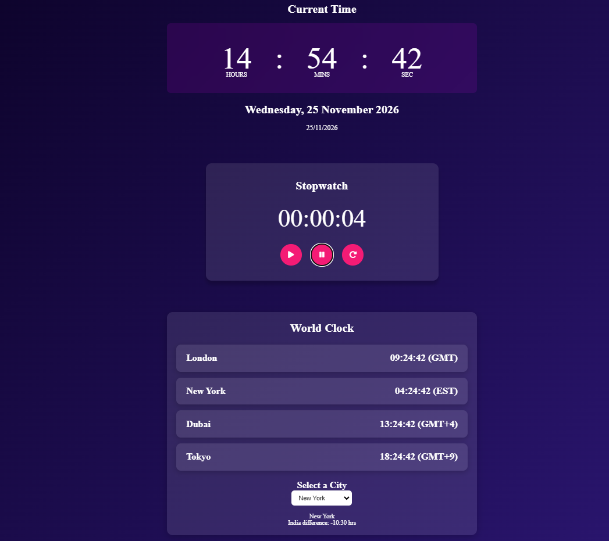

# Digital Clock, Stopwatch & World Clock

A responsive web-based clock application built using **HTML, CSS, and JavaScript**. This project combines three useful time-related features in one simple and user-friendly interface.

## Features

- **Digital Clock:** Displays the current time and date in real time.
- **Stopwatch:** Start, pause, and reset the stopwatch.
- **World Clock:** Displays current times in different cities around the world.
- **Live Updates:** Automatically updates the displayed time.

## Technologies Used

- HTML5
- CSS3
- JavaScript

## Screenshot



## 📂 Project Structure

```text
digital-stopwatch-world-clock/
│
├── index.html
├── style.css
├── script.js
├── README.md
└── Clock.png
```

## Live Demo
**[Demo link](https://jasnafathim.github.io/Digital-Clock/)**  
The project focuses on creating a clean, simple, and user-friendly interface while demonstrating the use of JavaScript for real-time updates, time calculations, and interactive functionality. The responsive design allows the application to work effectively on both desktop and mobile devices.

## Connect with Me
- [](https://www.linkedin.com/in/jasnafathim/)
- [](https://medium.com/@jasnafathim/)
- [](https://github.com/Jasnafathim/)


